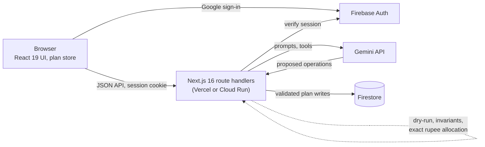

# Utsav: AI celebration planner

<!-- Owner: replace the three placeholders below after deploying (README "Deploy") and recording the video. -->
**Live demo:** https://utsav-planner-app.vercel.app (start at `/demo`, no sign-in needed) · **Demo video:** `<video link>` · **LinkedIn post:** `<post link>`

Utsav is a planning workspace for Indian celebrations: weddings, birthdays and community events. You create an event once and Utsav keeps a living plan for it: a budget that always adds up, a timeline counted back from the event day, a vendor checklist and ideas that fit the people being celebrated. Gemini is a co-planner that **proposes** changes, code **checks** them, and you **decide**.

Built for Google Cloud PromptWars, Challenge 5: Celebration & Event Planner.

## Try it: the public demo

No sign-in needed. Start at **`/demo`** and pick a sample:

| Sample | What to try |
| --- | --- |
| **Wedding · Pune** (`/demo/wedding`): 350 guests, 5 functions (haldi, mehndi, sangeet, wedding, reception), ₹25,00,000 | Opens on the Budget tab with AI mode pre-filled: "Cut decor spend by 20%". Accept a card, then ask "Make that 15% instead": the follow-up builds on the new amount. Undo restores it; a reload starts the sample again. |
| **6th birthday · Bengaluru** (`/demo/birthday`): 40 guests, a girl who loves Peppa Pig and painting, Jain food | Ideas tab, "Suggest ideas": cartoon-character decor and a kids' painting station, from her age, interests and diet (never her name). |
| **Diwali · Chennai** (`/demo/community`): a residents' association, 600 people, volunteer-run | Ideas tab, "Suggest ideas": rangoli by age group and other ideas for a mixed community, plus AI mode for volunteer tasks. |

The demo is a sandbox: changes live in your browser only. AI mode and ideas call live Gemini (5 calls an hour per visitor, plus a global daily cap); past either limit, or if the model fails, a clearly labelled recorded example answers instead, checked against your copy of the sample.

## How this meets the brief

> Create a GenAI-powered planning assistant that helps users organize weddings, birthdays, and community events with budgets, timelines, vendor checklists, and personalized ideas.

| | Wedding | Birthday | Community event |
| --- | --- | --- | --- |
| **Budget** | ₹25,00,000 across venue, catering (Marathi and Punjabi counters), decor, attire, photography and more, also split by function (haldi, mehndi, sangeet, wedding, reception). Edits rebalance so it always adds up; What-if re-plans for a new total | ₹60,000 across venue, food and cake (Jain menu), decor, entertainment and return gifts | Decor and lighting, rangoli supplies, food stalls, sound and stage, safety and first aid, prizes. Every budget keeps a contingency |
| **Timeline** | Tasks counted back from the wedding day, alongside each function's date and time; rushed and overdue flags | Venue, theme, invitations, entertainer, cake and the Jain menu, counted back from the party | Hall booking, volunteer roster, registrations, a fire-safety briefing, then clean-up and thank-yous after the day |
| **Vendor checklist** | Venue, caterer, photographer, mehndi artist, pandit and more: a status pipeline, quotes and payments, and enquiry drafts in English or Hindi | Venue, baker (with questions such as an eggless Peppa Pig cake), decorator, entertainer | Sound and lighting, a caterer for the food stalls, tent and seating, a first-aid kit, eco-friendly lights |
| **Personalised ideas** | From the functions, tradition, season and city | From the child's age, interests and diet (never the name) | From the festival, the age mix and the size of the community |

Gemini drafts the plan, answers plain-language requests ("Move the sangeet to Friday") with function calling, re-plans What-if and writes vendor enquiries. Code checks every change, and nothing applies until you accept it. Every cell above can be tried in the public demo (`/demo/wedding`, `/demo/birthday`, `/demo/community`).

## Google services used

- **Gemini API** (`@google/genai`, free tier from Google AI Studio): plan generation with a JSON schema, AI mode with **function calling** (one tool per plan operation), What-if re-planning, ideas and enquiry drafts. Called only from the server; no key reaches the browser. The same code runs on Vertex AI with `GOOGLE_GENAI_USE_VERTEXAI=true`.
- **Firebase Authentication**: Google sign-in, exchanged for an httpOnly session cookie by `POST /api/session`.
- **Cloud Firestore** (Native mode, asia-south1): events, profiles, proposals and share links, reached only from the server through the Firebase Admin SDK (client rules deny all).

The live demo runs on Vercel's free Hobby plan with Firebase's free Spark plan, so it needs no billing account. The Dockerfile also runs it on Cloud Run (see "Deploy").

## Features

| Area | What it does | Where |
| --- | --- | --- |
| Landing, demo, privacy | Public pages; `/privacy` explains what reaches the AI and how to delete data | `/`, `/demo`, `/demo/[sample]`, `/privacy` |
| Sign-in and onboarding | Google sign-in (Firebase Auth, session cookie), a 4-step skippable profile (role, budget style, language) | `/signin`, `/onboarding`, `/settings` |
| Dashboard | Upcoming and past events with progress and days to go | `/dashboard` |
| New event wizard | Type, occasion, date, city, guests, budget, functions (date, times, share), honorees, tradition, diet; AI plan with template fallback | `/events/new` |
| Review your new plan | The generated plan opens with per-section "Looks good" or "Reset to the starter template" | event Overview |
| Budget | Edit amounts with pinned rebalance, "By function" shares, What-if (simple rescale, or smart re-plan with an editable After column and trade-off cards) | `/events/[id]/budget` |
| Timeline | Tasks by phase, dates counted from the event day, rushed and overdue flags, function times | `/events/[id]/timeline` |
| Vendors | Status pipeline, quotes and payments, notes, history; enquiry drafts for WhatsApp or email in English or Hindi | `/events/[id]/vendors` |
| Guests | Counts, dietary split and a plate estimate | `/events/[id]/guests` |
| Ideas | Personalised suggestions (AI, or "From Utsav's idea library"), save, dismiss, add to plan | `/events/[id]/ideas` |
| AI mode | Ask in plain words ("Move the sangeet to Friday"); every change comes back as a card to accept, edit, decline or restore, then undo | every workspace tab |
| Event settings | Edit details with a date-change preview, delete the event, read-only share link, `.ics` calendar export | `/events/[id]/settings`, `/s/[token]` |

## How GenAI is used

| Touchpoint | AI | Code |
| --- | --- | --- |
| T1 plan generation | Budget split, functions, tasks, vendor categories, ideas (JSON schema) | Validates, allocates rupees exactly (largest remainder), schedules dates; template fallback |
| T2 AI mode | Gemini **function calling**: one tool per operation (adjust a budget category, move a function, add a task …), the last 4 turns as context | Resolves names to ids, dry-runs every op against the plan, returns invalid ones as labelled invalid cards; nothing applies without a click |
| T3 What-if | New category weights, notes, trade-offs | Maps weights onto the plan's own lines, keeps protected lines, sums exactly |
| T4 Ideas | Ideas from the honorees' age, interests, tradition, festival, season, city and budget tier | Drops repeats and dismissed ideas; idea library fallback |
| T5 Enquiry drafts | A draft message in the chosen channel, language and tone | Never sends it; strips names and contact details, appends the sign-off; template fallback |

The model never writes to a plan directly: AI output becomes a stored proposal, and the only AI write path is the user's decision on it (`/proposals/[pid]/decide`). Prompts carry plan data as fenced JSON, the system instruction tells the model to ignore instructions inside it, and an output filter removes contact details and invented vendor names. Honoree names and notes, the event title, vendor labels and contacts are never sent to the model.

## Architecture



The model never writes to Firestore: its output becomes a proposal that code validates and you accept or decline.

```
src/
  app/                    App Router: (marketing), (auth), (app) route groups, /s/[token], API routes (one-line re-exports)
  proxy.ts                Cookie-presence redirects and share-token checks (Next 16 "proxy", formerly middleware)
  components/             Accessible React UI: shell, workspace tabs, AI panel and cards, demo, forms
  lib/
    domain/               Pure planning logic: schemas, budget, dates, timeline, catering, ics, ops (apply, dry-run, invariants)
    ai/                   Prompts, Gemini wrapper (@google/genai), tools, per-touchpoint services, output filter
    plan/                 PlanStore implementations (server, sandbox, local), proposals, commands
    data/                 Browser API clients (plan, AI, sandbox AI, auth)
    server/               Route handlers, auth guard, Firestore repositories, rate limits, caches, CSP, demo quota
    demo/                 Sample fixtures and recorded fallbacks
tests/                    Vitest unit, component and route-handler tests (in-memory Firestore, fake model, test doubles in helpers/)
e2e/                      Playwright end-to-end and axe accessibility checks
```

### API

| Route | Purpose |
| --- | --- |
| `POST/DELETE /api/session` | Sign in (ID token to session cookie) and out |
| `GET/PUT /api/profile`, `DELETE /api/account` | Profile; account deletion |
| `GET/POST /api/events`, `GET/PATCH/DELETE /api/events/[id]` | List, create (T1), read, edit with ops, delete |
| `POST /api/events/[id]/undo`, `PUT /review` | Undo a batch; review sections |
| `POST /api/events/[id]/proposals`, `POST /proposals/[pid]/decide` | Code proposals; accept / edit / decline / restore |
| `POST /api/events/[id]/ai/{instruct,ideas,whatif,enquiry}` | T2-T5 (signed in; 6 a minute, 60 a day per user; cached 10 minutes) |
| `POST /api/demo/[sample]/ai/{instruct,ideas}` | Demo sandbox AI (public; 8 KB body, 5 an hour per IP, global daily cap, recorded fallback) |
| `GET /api/events/[id]/calendar.ics` | Calendar file |
| `POST/DELETE /api/events/[id]/share` | Read-only link |
| `GET /api/health` | Health check |

## Quality

| Area | What's in place |
| --- | --- |
| **Testing** | 1,931 Vitest tests (domain, AI with a fake model including personalisation and prompt-injection evals, every route handler, components) with 95% line coverage thresholds; 123 public Playwright end-to-end and axe checks on desktop and mobile; 114 signed-in Playwright tests and 23 Firestore-rules and Admin SDK tests on the Firebase emulators. Prettier and ESLint on every file. |
| **Security** | Firestore is server-only (client rules deny all); httpOnly session cookies; same-origin checks on every mutation; Zod on every body with size limits; per-user and per-IP rate limits; route-group CSP and security headers; no keys in the browser (Vertex AI uses the Cloud Run service account). Someone else's event is a real HTTP 404, never a 403: the APIs check ownership, and the proxy checks it on a full page load of `/events/{id}` before anything streams (one event read per hard load; tab switches are not checked). **Sign-out trade-off (spec 9.1):** writes check session revocation, reads do not (that check is a call to Firebase Auth on every page view). So a copied session cookie can still read pages, `GET` APIs and the `.ics` file for up to 5 days after sign-out; it can never write, and after account deletion it reads nothing (the data is gone and a session without a profile counts as signed out). |
| **Efficiency** | AI replies cached by plan version; cancelled requests abort the model call; public pages are prerendered and do not download the signed-in data layer (its provider lives in the signed-in layouts); What-if previews need no AI call. |
| **Accessibility** | WCAG 2.2 AA: landmarks, labelled fields with error summaries, live announcements, visible focus, reduced-motion support, 44 px targets; axe in E2E. |

## Run locally

Requires Node 22+.

```bash
npm install
cp .env.example .env.local
npm run dev
```

Every variable is optional. With none set, the public pages and the demo work (the demo answers with recorded examples), and sign-in shows "Sign-in isn't configured on this deployment". Add `GEMINI_API_KEY` for live AI, and the Firebase variables (see `.env.example`) for sign-in and saved events.

## Tests

```bash
npm test               # unit, component and route-handler tests
npm run test:coverage  # with coverage thresholds
npm run test:e2e       # builds the app and runs Playwright + axe (signed-out pages and the demo)
npm run test:emulator  # Firestore rules and the Admin SDK adapters on the Firebase emulators
npm run test:e2e:emulators  # signed-in journeys, axe and keyboard passes on the emulators
npm run format:check   # Prettier
npm run check          # lint + format + typecheck + coverage
```

The emulator scripts start the Auth and Firestore emulators (`firebase.e2e.json`, ports 3480-3484) with `firebase-tools`, which needs Java 21 for Firestore. Sign-in uses the Auth emulator's Google provider and the real `POST /api/session`; Gemini is a scripted local server reached through the SDK's `GOOGLE_GEMINI_BASE_URL`. The app has no test-only routes or flags (`tests/unit/e2eIsolation.test.ts`).

## Deploy

The Firebase web config (`NEXT_PUBLIC_FIREBASE_*`) is inlined into the browser bundle **at build time**, so it lives in the committed **`.env.production`**. Those four values are public by design (Firebase protects the project with authorised domains and server-only Firestore rules); nothing secret belongs in that file. `NEXT_PUBLIC_FIREBASE_AUTH_DOMAIN` is the app's own host, because `/__/auth` is proxied same-origin.

### Vercel + Firebase Spark (free, no billing account)

1. Firebase (Spark plan): enable Google sign-in, create Firestore (Native, asia-south1), then deploy the rules and indexes with `npx firebase-tools deploy --only firestore --project <project-id>`. Firestore TTL policies need billing, so on Spark drop the two `fieldOverrides` from that deploy; old undo history and proposals then stay until deleted instead of expiring.
2. Fill in `.env.production` from Firebase console > Project settings > Your apps > Web app.
3. Import the GitHub repo on Vercel (Next.js is detected) with these environment variables:

| Variable | Value |
|---|---|
| `FIREBASE_PROJECT_ID` | the Firebase project ID |
| `FIREBASE_SERVICE_ACCOUNT` | the Admin SDK service-account JSON key (or its base64), from Project settings > Service accounts. **Secret.** |
| `GEMINI_API_KEY` | a Gemini API key from Google AI Studio. **Secret.** |
| `GEMINI_MODEL` | optional; leave unset to use the `gemini-flash-latest` alias, which follows Google's model retirements |
| `APP_ORIGIN` | `https://<project>.vercel.app` |

4. Set the function region to Mumbai (`bom1`) next to Firestore, and redeploy.
5. Put the Vercel host in `NEXT_PUBLIC_FIREBASE_AUTH_DOMAIN`, add it to Firebase Auth's authorised domains, and add `https://<host>/__/auth/handler` to the OAuth client's redirect URIs.
6. Check `https://<host>/api/health`: expect `"status":"ok"`, Firestore ok and the model reachable.

### Cloud Run (needs billing)

`gcloud run deploy --source .` builds the Dockerfile on Cloud Build and reads the same `.env.production`. On Cloud Run the server uses the service account (Application Default Credentials) instead of `FIREBASE_SERVICE_ACCOUNT`, and Gemini can run on Vertex AI:

```bash
gcloud run deploy utsav --source . --region asia-south1 --allow-unauthenticated \
  --min-instances=1 --max-instances=3 --cpu-boost \
  --set-env-vars GOOGLE_GENAI_USE_VERTEXAI=true,GOOGLE_CLOUD_PROJECT=$(gcloud config get-value project),GOOGLE_CLOUD_LOCATION=global,GEMINI_MODEL=<vertex-model-id>,APP_ORIGIN=https://<service-host>
```

The service account needs **Vertex AI User**, **Cloud Datastore User** and **Firebase Authentication Admin**. `docker build --build-arg NEXT_PUBLIC_FIREBASE_API_KEY=... .` overrides `.env.production` when building elsewhere. The test suites build with these values empty, so `npm run test:e2e` keeps testing the "not configured" build whatever the file holds.

**Always run behind a trusted proxy.** Per-IP rate limits key on the rightmost `X-Forwarded-For` entry, which Vercel's edge (it replaces the header) and Cloud Run's front end (it appends the client address) both set. A `next start` reachable directly lets a client write that header and pick its own rate-limit key, so never expose the Node server without such a proxy in front. The demo spends live AI only for requests from the app's own pages (same `Origin`); anything else gets a recorded answer, and the global daily cap bounds the cost either way. **Accepted risk (SEC-14):** on a server reached directly, a script that forges both `Origin` and `X-Forwarded-For` can spend live demo calls up to the global daily cap (it cannot read or change anyone's data). Behind Cloud Run's front end the rightmost `X-Forwarded-For` hop is the real client, so this needs a deployment mistake. It is not fixed in code on purpose: the app cannot tell which hop to trust without per-deployment configuration, and guessing wrong would either let forged addresses through or put every visitor behind one proxy address.

**Test-only settings are refused when deployed.** With `K_SERVICE` (Cloud Run) or `VERCEL` (Vercel) set, the server refuses to start when `FIRESTORE_EMULATOR_HOST`, `FIREBASE_AUTH_EMULATOR_HOST`, `GOOGLE_GEMINI_BASE_URL` or `GOOGLE_VERTEX_BASE_URL` is set: an emulator host makes firebase-admin accept unsigned cookies, and a base URL would send the Gemini key elsewhere.

**Local development with the emulators.** With `FIRESTORE_EMULATOR_HOST` set, the Admin SDK talks to Firestore over gRPC (REST would still ask for Application Default Credentials), so no credentials are needed locally.

## License

[MIT](LICENSE)
